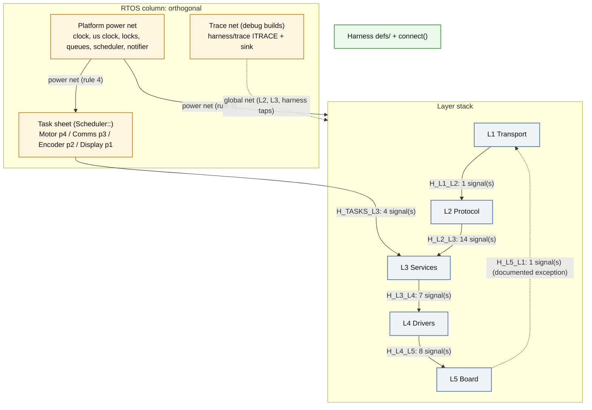

# Architecture

Generated by `scripts/arch/gen_architecture.py` from the harness definition tables in
`server/harness/defs/`. Do not edit by hand; edit the tables and regenerate.

## Rules

1. **Tasks call services.** The task sheet (`F_platform/tasks`) only waits, then calls one L3 entry point. Tasks never touch L1, L2, L4 or L5.
2. **Adjacent layers only.** L1 - L2 - L3 - L4 - L5, each through that boundary's harness. No skipping.
3. **One exception:** L5 -> L1 host command bytes through `Transport::IByteChannel` (owned by L1).
4. **Platform is a power net.** `F_platform/boundary` primitives may be used by any sheet; L3 contains no RTOS loops and is host-testable. `harness/trace/` is the second global net (debug builds only, see below).
5. **The composition root may see every sheet.** `server/main.cpp` + `system_init.cpp` call the Platform, L5 and L3 init contracts and the task-init contracts directly; no other sheet may.

Enforced by `scripts/arch/check_includes.py --strict` and `scripts/arch/check_harness_defs.py --strict`.

## Layers

- **L1 Transport** — Byte-stream ingress/egress to the host (VCP UART / RTT); owns ITransport and the IByteChannel contract that L5 implements. (7 files)
- **L2 Protocol** — SCPI parsing, validation, aliases, all host-facing formatting (responses, events, telemetry, joystick, banner); routes to the 13 L3 dispatchers. (21 files)
- **L3 Services** — All business logic and safety, host-testable, no RTOS loops: Motor/Comms/Encoder/Display/Debug services, controllers, dispatchers, telemetry store, UI, trace. (173 files)
- **L4 Drivers** — Device drivers over Board pin bundles: powerSTEP01, ST7789, NOR flash, joystick, quadrature encoder (+ index ISR), config store, debug access. (22 files)
- **L5 Board** — Register/peripheral access: clocks, GPIO, SPI1/SPI2, USART2 + RTT byte channels, TIM4, TIM3+DMA sampler, EXTI, TE sync, internal flash, bring-up commands. (35 files)
- **TASKS Task sheet (Scheduler::)** — Four RTOS task loops that only wait, then call one L3 entry point; owns priorities, periods, stack sizes, task handles and the task-init contracts the composition root calls. (16 files)
- **PLATFORM Platform (power net)** — RTOS-neutral primitives any sheet may use: clock, microsecond clock, locks, queues, scheduler, task stats, critical section, task notifier; FreeRTOS implementations, startup. (51 files)
- **HARNESS Harness** — Harness definitions (defs/), connect() functions (the only place taps are applied), shared POD pins, traced taps, interface trace. (61 files)
- **SYSTEM Composition root** — main.cpp + system_init.cpp: phase sequencing, Platform resources, RTOS task creation over the L3 services. (3 files)

## Global nets

Two header sets are wired like power rails: any sheet may include them directly, no harness row describes them.

- **PLATFORM Platform power net** (`server/foundation/F_platform/boundary`) — rule 4: RTOS-neutral primitives (clock, us clock, locks, queues, scheduler, task stats, critical section, notifier) usable by any sheet without a harness. Direct includers: HARNESS 9, L2 3, L3 15, L4 1, L5 1, PLATFORM 6, TASKS 12.
- **TRACE Interface trace net** (`server/harness/trace`) — second global net: ITRACE()/ITrace::log and the trace sink may be included by any sheet; compiled to no-ops unless ENABLE_INTERFACE_TRACE (firmware-debug); sink = L3 trace ring via Trace::initTraceSink. Direct includers: HARNESS 6, L2 2, L3 7.

## Harnesses

### H_L1_L2 — Protocol <-> Transport

`server/harness/defs/harness_l1_l2.hpp` — H_L1_L2 — the ONLY header through which L2 Protocol and L1 Transport see each other.

| Signal | Provider | Flow | Timing | Context | Ownership |
|---|---|---|---|---|---|
| `Transport::ITransport` | Lower | Down | Sync | Task, PreScheduler | caller-owned buffers; L1 owns the RX ring (via L5) and TX polling |

### H_L2_L3 — Protocol <-> Services

`server/harness/defs/harness_l2_l3.hpp` — H_L2_L3 — the ONLY header through which L2 Protocol and L3 Services see each other.

| Signal | Provider | Flow | Timing | Context | Ownership |
|---|---|---|---|---|---|
| `Services::IMotionDispatcher` | Lower | Down | Sync | Task | args by value |
| `Services::IMotorConfigDispatcher` | Lower | Down | Sync | Task | args by value |
| `Services::ISafetyDispatcher` | Lower | Down | Sync | Task | caller-owned fault string buffer |
| `Services::IQueueDispatcher` | Lower | Down | Sync | Task | commands copied into the L3 CommandQueue |
| `Services::IControlModeDispatcher` | Lower | Down | Sync | Task |  |
| `Services::ISupervisorTrimDispatcher` | Lower | Down | Sync | Task |  |
| `Services::IEncoderDispatcher` | Lower | Down | Sync | Task | EncFilterParams by value; may restart DMA sampling |
| `Services::IMotorDriverDispatcher` | Lower | Down | Sync | Task | setStepMode suspends the Motor task via Platform |
| `Services::IDisplayDispatcher` | Lower | Down | Sync | Task | bitmap/stream bytes consumed before return; SPI1 mutex |
| `Services::IFlashImageDispatcher` | Lower | Down | Sync | Task | chunk buffers caller-owned; SPI2 mutex |
| `Services::ISystemDispatcher` | Lower | Down | Sync | Task | getTelemetry copies the snapshot under the telemetry mutex |
| `Services::ITraceDispatcher` | Lower | Down | Sync | Task | entries copied out |
| `Services::IDebugDispatcher` | Lower | Down | Sync | Task | locked until DBG:UNLOCK; output via the L2-owned IResponseSink |
| `Protocol::ICommandProcessor` | Upper | Up | Sync | Task | L2 owns transport, line buffer, formatting; AsyncEvent by const ref |

### H_L3_L4 — Services <-> Drivers

`server/harness/defs/harness_l3_l4.hpp` — H_L3_L4 — the ONLY header through which L3 Services and L4 Drivers see each other.

| Signal | Provider | Flow | Timing | Context | Ownership |
|---|---|---|---|---|---|
| `Drivers::IMotorDriver` | Lower | Down | Sync | Task, PreScheduler | blocks on SPI1 mutex; traced tap is a pure observer |
| `Drivers::ICanvas` | Lower | Down | Sync | Task, PreScheduler | blocks on SPI1 mutex; stream buffers caller-owned until streamBitmapEnd; waitForVSync busy-waits <= 18 ms |
| `Drivers::IJoystick` | Lower | Down | Sync | Task | optional |
| `Drivers::IFlash` | Lower | Down | Sync | Task | blocks on SPI2 mutex; optional |
| `Drivers::IEncoderHardware` | Lower | Down | Sync | Task, ISR | indexISR only from the L5 EXTI callback; index fields published as a seqlock snapshot (readIndex) |
| `Drivers::IDebugAccess` | Lower | Down | Sync | Task | raw bring-up commands pass-through to L5; gated by L3 DebugService |
| `Drivers::IConfigStore` | Lower | Down | Sync | Task, PreScheduler | erase/write block for the flash operation; read copies into caller buffer |

### H_L4_L5 — Drivers <-> Board

`server/harness/defs/harness_l4_l5.hpp` — H_L4_L5 — the ONLY header through which L4 Drivers and L5 Board see each other.

| Signal | Provider | Flow | Timing | Context | Ownership |
|---|---|---|---|---|---|
| `Board::ISPIBus (SPI1 motor+lcd, SPI2 flash)` | Lower | Down | Sync | Task, PreScheduler | bus owned by SPIManager; per-bus Platform mutex; caller buffers |
| `Board::IGPIO (per pin)` | Lower | Down | Sync | Task, ISR, PreScheduler | L5 statics |
| `Board::ITimerCounter (TIM4)` | Lower | Down | Sync | Task | 16-bit, wraps |
| `Board::IEncoderSampler (TIM3+DMA1)` | Lower | Down | AsyncFlag | Task | 256-entry DMA ring owned by L5; reader keeps its own index |
| `Board::ITearingSync (EXTI0)` | Lower | Down | AsyncFlag | Task | flag set at NVIC 4 (no RTOS calls); bounded 18 ms wait |
| `Board::IInternalFlash` | Lower | Down | Sync | Task, PreScheduler | blocks for erase/program |
| `Board::IBoardDebug` | Lower | Down | Sync | Task | register-level bring-up commands; text via IResponseSink |
| `registerExti (index pulse)` | Lower | Up | AsyncFlag | ISR | callback table in harness; runs at NVIC 5 (RTOS-safe) |

### H_L5_L1 — Transport <-> Board

`server/harness/defs/harness_l5_l1_bytes.hpp` — X_L5_L1 — the ONE documented layer skip (rule 3): host command bytes, L5 -> L1

| Signal | Provider | Flow | Timing | Context | Ownership |
|---|---|---|---|---|---|
| `Transport::IByteChannel` | Lower | Up | AsyncFlag | Task, ISR | ring owned by L5; ISR producer (NVIC 6); caller-owned read buffer; may notify the Comms task |

### H_TASKS_L3 — Scheduler (tasks) <-> Services

`server/harness/defs/harness_tasks_l3.hpp` — H_TASKS_L3 — the ONLY connection between the task sheet (F_platform/tasks,

| Signal | Provider | Flow | Timing | Context | Ownership |
|---|---|---|---|---|---|
| `Services::IMotorService` | Lower | Down | Sync | Task | MotorCommand by const ref for the call; L3 owns driver + controller; ESTOP latch + step-mode/debug-pause messages handled on the Motor task |
| `Services::ICommsService` | Lower | Down | Sync | Task | L3 owns parser ref, heartbeat, telemetry publish, event drain |
| `Services::IEncoderService` | Lower | Down | Sync | Task | optional task; L3 owns processor, filters, DMA read index |
| `Services::IDisplayService` | Lower | Down | Sync | Task | L3 owns ScreenManager, screens, joystick state, UI mode; debug disable is a flag checked by tick() |

## Tasks

| Task | Priority | Stack (words) | Trigger | Period (ms) | Body |
|---|---|---|---|---|---|
| Motor | 4 | 1024 | event | 50 | queue receive (50 ms timeout) -> IMotorService::onCommand; every 50 ms -> IMotorService::periodicUpdate |
| Comms | 3 | 2048 | event | 10 | ITaskNotifier wait (USART2 RX wake) with 10 ms fallback -> ICommsService::tick |
| Encoder | 2 | 256 | periodic | 10 | sleepUntil 10 ms -> IEncoderService::sample (task not created without encoder hardware) |
| Display | 1 | 640 | periodic | 50 | sleepUntil 50 ms -> IDisplayService::tick |

## Diagram

